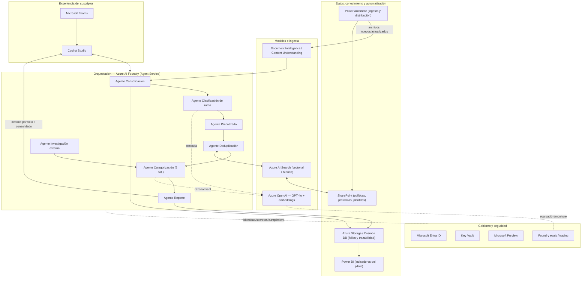

# SBS Underwriting Copilot — Guion de demo y arquitectura

> Prototipo **local** para demostración. El motor de clasificación es una **simulación
> determinista** del pipeline de agentes de Azure AI Foundry; los folios son **datos
> sintéticos** (no información real de SBS).

---

## 1. Preparación (antes de la reunión)

Dos terminales, uno para el backend y otro para el frontend.

**Terminal 1 — Backend (API FastAPI):**
```powershell
cd backend
python -m venv .venv
.\.venv\Scripts\Activate.ps1
pip install -r requirements.txt
uvicorn app.main:app --port 8000
```
API en http://localhost:8000 · documentación interactiva en http://localhost:8000/docs

**Terminal 2 — Frontend (React + Vite):**
```powershell
cd frontend
npm install
npm run dev
```
Interfaz en http://localhost:5173 (hace proxy de `/api` al backend en el puerto 8000).

**Checklist previo:**
- Abrir http://localhost:5173 y confirmar que cargan los KPIs y la tabla de folios.
- Tener a la vista el documento del plan por si surgen preguntas de alcance.
- Recordar el mensaje central: *el Copilot analiza y recomienda; el suscriptor decide*.

---

## 2. Paso a paso de la demo (≈ 10–12 min)

### Paso 1 — Contexto y problema (1 min)
Mostrar el bloque **“Línea base (histórico citado en el plan)”**:
- 2.460 folios al año, 4 suscriptores (~615 por persona).
- 53,9% terminan cerrados administrativamente o declinados tras consumir tiempo.
- Mensaje: el piloto interviene tempranamente ese segmento, sin asumir el resultado.

### Paso 2 — Vista de equipo y priorización (2 min)
Mostrar el bloque **“Piloto — folios analizados por el Copilot”**:
- % analizados, duplicados detectados, vencidos sin decisión.
- Las **barras por categoría** (1 a 5) muestran cómo el Copilot distribuye la carga.
- Mensaje: cada suscriptor ve su carga priorizada; el líder ve el consolidado del equipo.

### Paso 3 — Filtrar por suscriptor (1 min)
En **Suscriptor**, elegir *Mariana Pérez Londoño*:
- Aparece el **resumen individual** (pendientes, con decisión, duplicados, vencidos).
- Mensaje: cada persona entra directamente a “sus” folios y sus prioridades del día.

### Paso 4 — Detectar duplicados y vencidos (1 min)
- En la tabla, señalar un folio con **“⚠ posible duplicado”**.
- Señalar una **fecha máxima en rojo** (vencido sin decisión).
- Mensaje: deduplicación semántica (NIT, ramo, vigencia) y control de oportunidad.

### Paso 5 — Abrir el informe de un folio (3 min) — el corazón de la demo
Clic en **“Ver informe”** de un folio. Recorrer el modal de arriba hacia abajo:
1. **Resumen del folio**: cliente, intermediario, NIT, fechas.
2. **Adjuntos**: incluir uno marcado **“no procesable”** → *nunca se asume su contenido*.
3. **Separación de resultados (trazabilidad por fuente)**: información del solicitante,
   de documentos, histórica interna, fuentes externas, listas restrictivas y reglas de
   suscripción, cada una citando su origen.
4. **Recomendación del Copilot**: categoría (1–5), nivel de confianza, resultado sugerido
   y próximo paso. Mostrar los **hallazgos**.

### Paso 6 — Decisión humana (2 min)
En **“Decisión final (humana)”**:
- Escribir una decisión y elegir una **retroalimentación** (correcta, parcial, categoría
  modificada, etc.) y **Guardar decisión**.
- Mensaje: ninguna recomendación se aplica sola; el suscriptor aprueba y retroalimenta
  (aprendizaje gobernado).

### Paso 7 — Analizar un folio nuevo (1 min, opcional)
- Filtrar por **Estado = “Nuevo (sin analizar)”**, abrir uno y pulsar **“Analizar folio”**.
- El Copilot ejecuta la clasificación en vivo y propone categoría y próximo paso.

### Cierre (30 s)
Volver al dashboard: *de 2.460 folios dispersos a análisis estructurados, trazables y
accionables, conservando la decisión en manos humanas.*

---

## 3. Modelo de decisión de cinco categorías

| Cat. | Situación | Resultado principal | Intervención humana |
|------|-----------|---------------------|---------------------|
| 1 | Información mínima insuficiente | Solicitud de información | Revisar y enviar |
| 2 | Inquietudes o contradicciones | Solicitud de aclaración | Revisar preguntas |
| 3 | Riesgo fuera de lineamientos | Declinación sustentada | Aprobar decisión |
| 4 | Riesgo elegible y estandarizable | Cotización preliminar | Revisar y aprobar |
| 5 | Riesgo elegible no estandarizable | Informe y sugerencias | Estructurar y decidir |

---

## 4. Arquitectura lógica de servicios (solución destino)

Arquitectura de referencia descrita en el plan. El prototipo local simula las capas de
**Orquestación** y **Modelos** con reglas deterministas; el resto representa la solución
productiva sobre Azure.



### Flujo de procesamiento por folio
1. **Ingesta** — Power Automate detecta archivos nuevos/actualizados y los deposita en entrada.
2. **Extracción** — Document Intelligence procesa cada adjunto; los no procesables se marcan.
3. **Consolidación** — el agente arma una vista única del folio.
4. **Deduplicación** — búsqueda vectorial por NIT, razón social, ramo, producto y vigencia.
5. **Enriquecimiento** — ramo, precotizado, investigación externa y alertas de cumplimiento.
6. **Categorización** — asignación a una de las cinco categorías con nivel de confianza.
7. **Reporte** — informe por folio + resumen consolidado del suscriptor; revisión y feedback.

### Correspondencia prototipo ↔ solución destino

| Capa del plan | En la solución destino (Azure) | En este prototipo local |
|---------------|-------------------------------|--------------------------|
| Experiencia | Copilot Studio + Teams | Frontend React (`frontend/`) |
| Orquestación | Azure AI Foundry — Agent Service | Pipeline de reglas (`store.py`) |
| Modelos | Azure OpenAI GPT-4o + embeddings | Motor determinista (`classifier.py`) |
| Ingesta documental | Document Intelligence | Adjuntos simulados en `seed.py` |
| Búsqueda / RAG | Azure AI Search | Detección de duplicados simulada |
| Datos y estado | Azure Storage / Cosmos DB | Almacenamiento en memoria |
| Visualización | Power BI | KPIs y barras en el dashboard |
| Gobierno | Entra ID, Key Vault, Purview, evals | Trazabilidad por fuente en el informe |

---

## 5. Mensajes clave para el cliente
- El Copilot **analiza primero y recomienda**; el suscriptor decide.
- Ninguna coincidencia en listas, noticia o hallazgo externo produce una decisión
  automática: debe verificarse identidad y fuente primaria.
- No se completa información mediante invención ni se asume lo no verificado.
- Toda recomendación es **explicable** y conserva su fuente (separación de resultados).
- La Fase 1 **no** accede a eDesk; la integración se difiere a una fase posterior.
